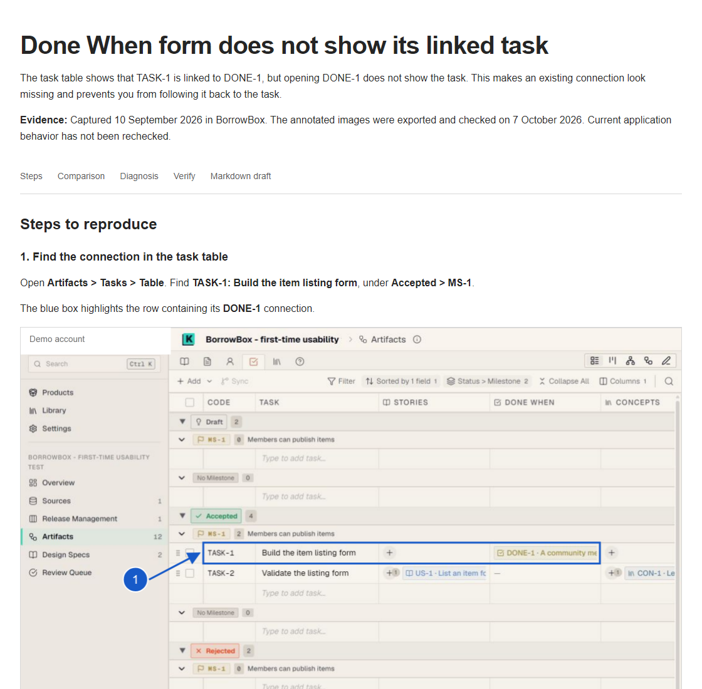
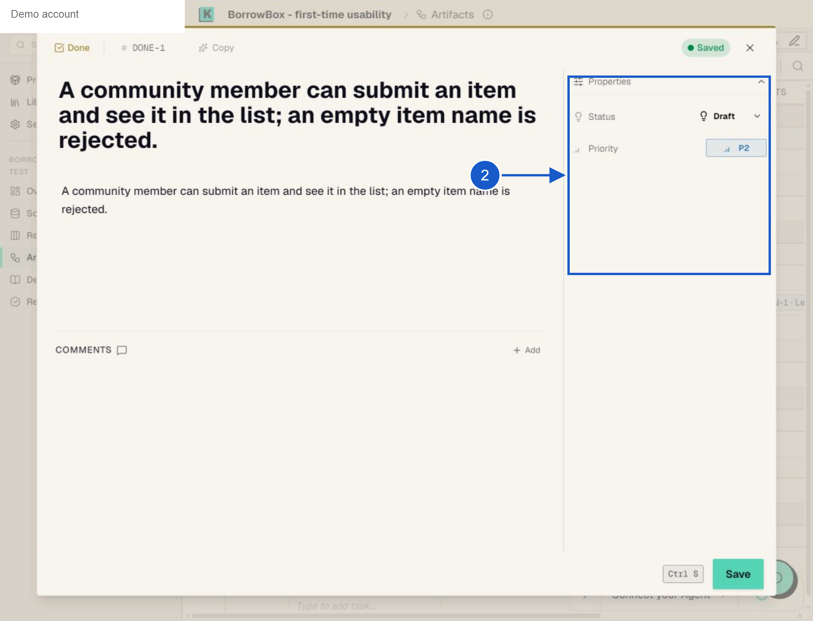
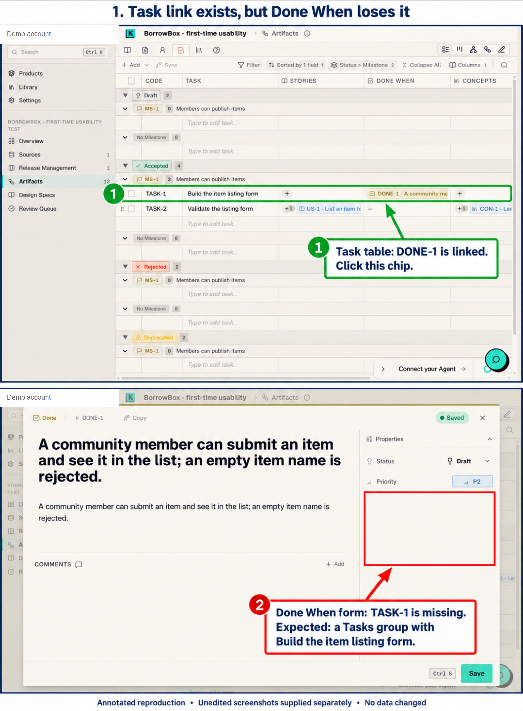

# Issue Walkthrough Skills

Explain a bug with clear steps, annotated screenshots and a report someone can follow. Export the same evidence to a GitHub issue draft.

## See it in action

A generated HTML report from the Auto-K Done When example:



The exported image keeps the SVG boxes, arrows and numbers embedded in the image:



<details>
<summary>See the annotated comparison</summary>



</details>

*Historical example, not a statement about current Auto-K behavior. Account details are masked in these showcase copies.*

## Three skills

| Skill | Use it to |
| --- | --- |
| [issue-walkthrough](skills/issue-walkthrough/SKILL.md) | Explain an issue in a local HTML report with steps and evidence. |
| [screenshot-annotations](skills/screenshot-annotations/SKILL.md) | Add SVG boxes, arrows and numbered callouts to real screenshots. |
| [github-issue-export](skills/github-issue-export/SKILL.md) | Prepare Markdown, annotated PNGs and a matching HTML preview. |

Works across repositories. The agent writes and checks the report; the Python script renders images. Publishing happens only when requested.

## Use it

Copy the skill folders you want into your agent's skills directory, such as `~/.codex/skills/`.

> Use $issue-walkthrough to explain this bug with annotated screenshots. Then use $github-issue-export to prepare a local GitHub draft.

For image export, install the dependencies from the repository root:

```sh
python -m pip install -r skills/github-issue-export/scripts/requirements.txt
python -m playwright install chromium
```

Reports use separate HTML and CSS templates under each skill's `assets/`. Export drafts live in the export skill's ignored `.cache/exports/` folder with `issue.md`, `index.html`, CSS, images and a manifest. Upload the images before publishing the Markdown to GitHub.

[MIT license](LICENSE). Screenshots retain their own rights.
